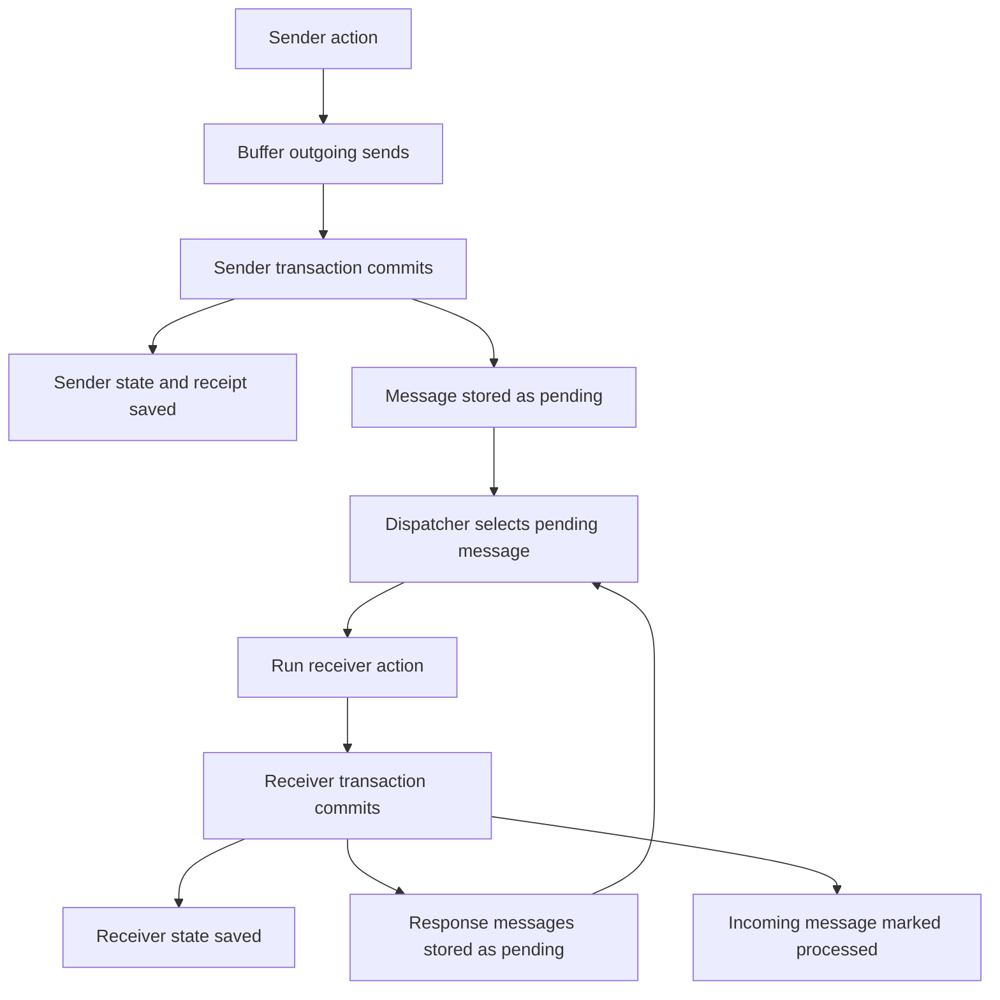
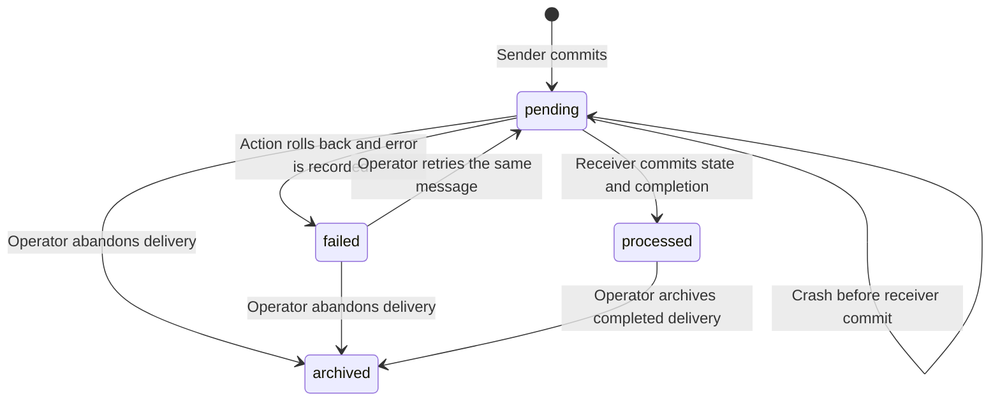

# Carina MVP Specification

Draft · October 30, 2026

Carina turns a TypeScript service into a self-hosted application with typed actors, durable state, durable actor messages, and reactive reads. Developers define state, actions, and named queries. Carina validates requests, commits state and messages to SQLite, and keeps connected clients up to date.

A service builds into one executable. Running it starts the application and its HTTP and WebSocket API. One data directory holds the database.

Carina is designed for small applications that need reliable state transitions and live interfaces: inventory tools, collaborative trackers, dashboards, and internal applications.

# Programming model

A service contains actor types and named queries.

An actor is a stateful object identified by a type and a string key. Its state is a JSON document described by Effect Schema. An action receives validated input and a mutable draft of that state, can send messages to other actors in the service, and returns a JSON reply. Carina validates and saves the resulting state and outgoing messages together.

A named query is a synchronous function defined by the service. It receives validated input and a read-only database connection. Clients can run it once or watch its result.

Service code is trusted application code and executes directly in Bun with the server process's privileges. Actions and queries are synchronous. Application code performs external work, such as calling a payment provider, around Carina calls.

# Inventory example

The service below stores products, reserves stock, and exposes a catalog query.

```typescript
import { Schema } from "effect";
import { actor, action, query, service } from "carina";

const NonNegativeInt = Schema.Int.pipe(Schema.nonNegative());
const PositiveInt = Schema.Int.pipe(Schema.positive());

class InsufficientStock extends Schema.TaggedError<InsufficientStock>()(
  "InsufficientStock",
  { available: NonNegativeInt },
) {}

const product = actor({
  state: Schema.Struct({
    name: Schema.NonEmptyString,
    stock: NonNegativeInt,
  }),
  errors: [InsufficientStock],

  actions: {
    reserve: action(
      { qty: PositiveInt },
      ({ state }, { qty }) => {
        if (qty > state.stock) {
          throw new InsufficientStock({ available: state.stock });
        }
        state.stock -= qty;
        return { stock: state.stock };
      },
    ),

    restock: action(
      { qty: PositiveInt },
      ({ state }, { qty }) => {
        state.stock += qty;
        return { stock: state.stock };
      },
    ),
  },
});

const CatalogRow = Schema.Struct({
  key: Schema.String,
  name: Schema.String,
  stock: NonNegativeInt,
});

export const inventory = service({
  name: "inventory",
  version: 1,
  actors: { product },

  queries: {
    catalog: query(
      { minStock: NonNegativeInt },
      ({ db }, { minStock }) =>
        db.all(
          CatalogRow,
          `SELECT key,
                  json_extract(state, '$.name') AS name,
                  json_extract(state, '$.stock') AS stock
           FROM actors
           WHERE type = 'product'
             AND json_extract(state, '$.stock') >= ?
           ORDER BY key
           LIMIT 1000`,
          [minStock],
        ),
    ),
  },
});

export type Inventory = typeof inventory;
export default inventory;
```

An application creates products, calls actions, and watches the catalog.

```typescript
import { client } from "carina/client";
import type { Inventory } from "./inventory";

const inventory = client<Inventory>({
  url: "http://localhost:7070",
  accessKey: process.env.CARINA_ACCESS_KEY,
});

await inventory.product.create(
  "sku-1",
  { name: "Trail Runner", stock: 10 },
);

await inventory.product("sku-1").reserve(
  { qty: 2 },
  { idempotencyKey: "reservation-42" },
);

const rows = await inventory.queries.catalog.query({ minStock: 1 });

for await (const rows of inventory.queries.catalog.watch({ minStock: 1 })) {
  renderCatalog(rows);
}
```

The reserve action checks and updates stock within one transaction. Concurrent reservations observe committed state in sequence. The catalog reads that state directly.

# API

## Service definitions

| Definition | Purpose |
| --- | --- |
| `service({ name, version, actors, queries, migrations })` | Defines one application and its storage version. |
| `actor({ state, actions, internal, errors, upgrades })` | Defines a state schema, public and internal actions, declared errors, and state upgrades. |
| `action(input, fn)` | Validates input and runs a synchronous state transition. |
| `query(input, fn)` | Validates input and runs a named read. |
| `upgrade(fromSchema, toSchema, fn)` | Defines a synchronous conversion between consecutive actor state versions. |

Action and query inputs accept an Effect Schema struct or a fields object. State schemas must encode to JSON. Replies and query results must be JSON values. Carina checks serialization before completing a request.

Action context contains `state`, `key`, `now`, `caller`, `messageId`, and `send`. The draft belongs to that invocation. `now` is the invocation's start time in milliseconds since the epoch. Declared errors use Effect Schema tagged errors.

`caller` is `{ kind: "client" }` for a gateway call or `{ kind: "actor", type, key }` for a delivered message. `messageId` is the incoming SQLite message ID exposed as a decimal string for actor deliveries. `send.type(key).action(input)` buffers an outgoing message and returns `void`. Public and internal action names are unique within an actor type.

Query context contains `db`. Its `all(rowSchema, sql, params)` method executes a parameterized read and decodes every row with the supplied schema. The read-only `actors` view presents state at each actor type's current version, applying pending upgrades in memory before SQL filters, sorts, or aggregates it. A query runs in one read transaction, giving all its reads a consistent snapshot. Queries use explicit ordering when result order matters.

## Client calls

| Call | Result |
| --- | --- |
| `app.product.create(key, state, options?)` | Creates an instance from validated initial state and returns its key. |
| `app.product(key).reserve(input, options?)` | Runs an action and returns its reply. |
| `app.queries.catalog.query(input)` | Returns the current query result. |
| `app.queries.catalog.watch(input)` | Returns an async iterator of query results. |

The client infers inputs, replies, and query results from the service type. Failed requests reject with a tagged error object. Mutation options accept `idempotencyKey`; the client generates a key when it is omitted and reuses that key for retries.

Returning from a watch loop closes its subscription. After a connection interruption, the client reconnects and requests a fresh result.

# Durable actor communication

Actors in one service communicate through durable messages stored in the service's SQLite database. Calling `send.type(key).action(input)` records an outgoing message in the current action's transaction and returns immediately. The dispatcher runs the target action after the sender commits.

One `messages` row serves as both the sender's outbox entry and the receiver's inbox entry. Its status records whether delivery is pending, processed, failed, or archived.

## Commit boundaries

The sender commits its state, request receipt, and outgoing messages together. A failed sender action preserves the prior state and discards its buffered sends.

The receiver commits its state, any messages it sends in response, and the incoming message's processed marker together. The dispatcher rechecks that the message is pending inside that transaction before executing it. A processed message is skipped.

A crash before the receiver commits leaves the message pending and the receiver's stored state unchanged. A crash after commit leaves both the state change and processed marker durable. Restarting resumes the pending queue. These guarantees cover state and messages stored in Carina.



A public action's reply acknowledges its own commit. The application observes the operation's eventual result through a named query or watch.

## Message table

```sql
CREATE TABLE messages (
  id INTEGER PRIMARY KEY AUTOINCREMENT,
  sender_type TEXT NOT NULL,
  sender_key TEXT NOT NULL,
  target_type TEXT NOT NULL,
  target_key TEXT NOT NULL,
  action TEXT NOT NULL,
  input TEXT NOT NULL,
  status TEXT NOT NULL DEFAULT 'pending'
    CHECK (status IN ('pending', 'processed', 'failed', 'archived')),
  attempts INTEGER NOT NULL DEFAULT 0,
  error TEXT,
  created_at INTEGER NOT NULL,
  processed_at INTEGER,
  archived_at INTEGER,
  archive_reason TEXT
);

CREATE INDEX messages_pending
  ON messages(id) WHERE status = 'pending';
```

The message ID identifies one durable row throughout its lifetime. The sender's type and key become the target action's authenticated actor caller. The input and error fields contain encoded JSON; timestamps use milliseconds since the epoch.

The dispatcher snapshots up to 64 already-committed pending message IDs in order:

```sql
SELECT id
FROM messages
WHERE status = 'pending'
ORDER BY id
LIMIT 64;
```

The dispatcher processes the snapshotted IDs serially inside one outer `BEGIN IMMEDIATE` transaction. Each delivery gets a savepoint: recheck status, decode input, load and upgrade the target state, run the action, validate its output and buffered sends, save state, insert outgoing messages, and mark the incoming message processed. The outer commit makes the successful turns durable together. New response messages become eligible in a later batch, after their sender commits. Watch refreshes and further dispatch are scheduled after the outer commit.

Pending messages are attempted in ID order. A failed or archived message leaves the pending queue, allowing later messages to proceed. An explicit retry returns the same failed row to pending.

## Reservation example

An order requests stock from a product. The product sends its result back, and the order records the outcome. Both actor types belong to one service.

```typescript
import { Schema } from "effect";
import { actor, action, query, service } from "carina";

const PositiveInt = Schema.Int.pipe(Schema.positive());
const Stock = Schema.Int.pipe(Schema.nonNegative());
const Status = Schema.Literal(
  "new", "reserving", "reserved", "rejected",
);

const product = actor({
  state: Schema.Struct({
    name: Schema.NonEmptyString,
    stock: Stock,
  }),

  internal: {
    reserveForOrder: action(
      { qty: PositiveInt },
      ({ state, caller, send }, { qty }) => {
        if (caller.kind !== "actor" || caller.type !== "order") {
          throw new Error("Expected an order actor");
        }

        const accepted = state.stock >= qty;
        if (accepted) state.stock -= qty;

        send.order(caller.key).reservationResult({ accepted });
        return null;
      },
    ),
  },
});

const order = actor({
  state: Schema.Struct({
    sku: Schema.NonEmptyString,
    qty: PositiveInt,
    status: Status,
  }),

  actions: {
    start: action({}, ({ state, send }) => {
      if (state.status === "new") {
        state.status = "reserving";
        send.product(state.sku).reserveForOrder({ qty: state.qty });
      }
      return { status: state.status };
    }),
  },

  internal: {
    reservationResult: action(
      { accepted: Schema.Boolean },
      ({ state, caller }, { accepted }) => {
        if (
          caller.kind !== "actor" ||
          caller.type !== "product" ||
          caller.key !== state.sku
        ) {
          throw new Error("Expected the selected product actor");
        }

        if (state.status === "reserving") {
          state.status = accepted ? "reserved" : "rejected";
        }
        return null;
      },
    ),
  },
});

export const shop = service({
  name: "shop",
  version: 1,
  actors: { product, order },
  queries: {
    orderStatus: query(
      { key: Schema.String },
      ({ db }, { key }) =>
        db.all(
          Schema.Struct({ status: Status }),
          `SELECT json_extract(state, '$.status') AS status
           FROM actors
           WHERE type = 'order' AND key = ?`,
          [key],
        ),
    ),
  },
});

export type Shop = typeof shop;

declare module "carina" {
  interface Register {
    service: Shop;
  }
}

export default shop;
```

`actions` contains gateway-callable actions. `internal` contains actions invoked by actor sends. Actors can send to either map. The service registration supplies the target types for `ctx.send`; the runtime checks the target actor type, action, and input before accepting a buffered send. Instance existence is checked during delivery.

Application code starts the operation and watches its outcome:

```typescript
import { client } from "carina/client";
import type { Shop } from "./shop";

const shop = client<Shop>({
  url: "http://localhost:7070",
  accessKey: process.env.CARINA_ACCESS_KEY,
});

await shop.product.create(
  "sku-1",
  { name: "Hiking Boot", stock: 10 },
);
await shop.order.create(
  "o-1",
  { sku: "sku-1", qty: 2, status: "new" },
);

await shop.order("o-1").start(
  {},
  { idempotencyKey: "start-order-o-1" },
);

for await (const rows of shop.queries.orderStatus.watch({ key: "o-1" })) {
  const order = rows[0];
  if (order?.status === "reserved" || order?.status === "rejected") {
    console.log(order.status);
    break;
  }
}
```

If stock is insufficient, the product commits a response with `accepted: false` and the order reaches `rejected`. That is a successfully processed message carrying a business result.

## Failures and recovery

If the target is missing, an input or state upgrade fails, or the target action throws, Carina rolls back that delivery's savepoint. It then records the failed status, attempt count, and error in a separate savepoint within the batch. Successful deliveries and recorded failures become durable at the outer commit. A crash before that commit preserves the incoming message's prior pending status, allowing another attempt after restart.

A successful delivery increments the attempt count and sets `processed_at` in its commit. Attempt counts represent recorded outcomes; a process killed during execution can leave an unrecorded attempt.

When a database commit's outcome is uncertain, the dispatcher pauses, reopens the database, and reads the message's status before continuing. A processed row is complete; a pending row remains eligible for delivery.



With the server stopped, operators inspect and manage messages through the executable:

```sh
./dist/shop messages list --status failed --data ./data
./dist/shop messages retry 42 --data ./data
./dist/shop messages archive 42 --reason "Order cancelled" --data ./data
```

Retry accepts a failed message and preserves its ID and payload. Processed messages remain complete. Archive records the reason and time; archiving a pending or failed message explicitly abandons its delivery. `processed_at` distinguishes archived completed messages from abandoned ones.

Message rows and completion markers are retained independently of gateway request receipts. The message status is the deduplication record for internal delivery, so the 24-hour client idempotency window does not affect message processing. Backups preserve the entire message table, including pending work.

Before serving, Carina checks pending messages against the executable's target action definitions and input schemas. An incompatible pending message produces a compatibility error. An explicit storage migration can transform queued inputs before serving a changed action contract. Failed messages are checked when retried.

# State and transactions

The server owns one SQLite database and one writer. Gateway mutation requests and dispatched actor messages execute serially, and ready actions can share a durable commit.

For each gateway mutation, Carina:

1. Authenticates the request and validates its input.

2. Creates a savepoint inside the writer's current transaction and checks its idempotency key.

3. Reads the stored state and its version, applies pending upgrades in memory, and creates a draft, or validates initial state for creation.

4. Runs the action, validates the resulting state and buffered sends, and serializes the reply.

5. Stores the state, its current actor state version, the request receipt, and outgoing message rows within that action's savepoint.

6. Releases the action's savepoint and holds its reply until the shared transaction durably commits. After commit, Carina replies, schedules watch refreshes, and wakes the message dispatcher.

A gateway receipt stores the request's identity, normalized input, reply, and completion time. Successful gateway actions store a receipt even when their state stays the same. Successful creation follows the same receipt rules, so retrying it returns the original result. Actor deliveries use the incoming message's processed marker as their durable deduplication record.

The database uses WAL mode and `synchronous=FULL`. A successful response means the outer transaction has durably committed. A lost connection can leave the client uncertain whether a commit succeeded; retrying with the same key resolves that uncertainty.

A query started after an acknowledged mutation sees that mutation or a later committed state. A second server process targeting the same data directory exits with a lock error.

## Group commits

Carina collects ready gateway calls until the next event loop turn and processes up to 64 actions in one outer SQLite transaction. Actions execute one after another and read the effects of preceding successful actions through the writer connection. Each action has its own savepoint.

The group shares the cost of a durable commit. Several concurrent callers can therefore achieve higher throughput, while a caller awaiting each reply before sending the next still pays individual commit latency. Members of a batch wait for its final commit, so a slow action increases latency for the group. The 64-action cap bounds action count rather than execution time.

Replies and watch notifications are released after the outer commit succeeds. Queries through the read connection see committed state. The dispatcher uses the same savepoint approach for batches of already-committed messages.

## Bounded mutation queue

One service-wide queue admits up to 1,024 waiting gateway mutations across all actor types and instance keys. Creation and action calls share this limit. The current executing batch, up to 64 actions, is separate from the waiting count.

When the queue is full, the gateway returns HTTP `503` with error tag `Overloaded` before enqueuing or executing the incoming call:

```json
{
  "error": {
    "_tag": "Overloaded",
    "message": "Mutation queue is full"
  }
}
```

A rejected attempt changes no state, inserts no outgoing messages, and records no new request receipt. Admission happens before receipt lookup, so retries are subject to the same capacity check. Existing committed receipts remain intact.

Draining a batch frees queue capacity. Callers retry later with the original idempotency key, allowing receipt lookup to return an earlier committed reply or execution to proceed if the operation has not committed. The client surfaces `Overloaded`; application code controls retry timing.

This limit counts waiting gateway mutations. Read queries and watches use their existing read path, and durable messages remain stored in SQLite and continue through the dispatcher.

## Savepoints and action failures

A savepoint is a checkpoint inside a transaction. Rolling back to a savepoint restores the database to the moment that action started, preserving earlier actions' provisional changes.

The following SQL shows the boundaries for three actions in one batch:

```sql
BEGIN IMMEDIATE;              -- Start the shared transaction

SAVEPOINT action_a;
-- A updates its state and inserts outgoing messages
RELEASE action_a;             -- Keep A's changes provisionally

SAVEPOINT action_b;
-- B changes state and buffers sends, then throws
ROLLBACK TO action_b;         -- Undo B's database changes
RELEASE action_b;

SAVEPOINT action_c;
-- C updates its state and inserts outgoing messages
RELEASE action_c;

COMMIT;                      -- Make A and C durable together
```

Bun's nested transaction wrapper rolls back an action's savepoint when it throws. Carina catches that action's error, discards its buffered sends, records its failed outcome, and continues the batch. B's state updates and outgoing message rows are undone together; A's earlier changes remain available to C.

`RELEASE` keeps changes within the outer transaction. Durability comes from the final `COMMIT`. A and C receive success only after it succeeds. If the outer commit fails, success replies are withheld and callers retry with their original idempotency keys. An uncertain commit outcome is resolved from the stored receipts after recovery. [SQLite savepoint semantics](https://www.sqlite.org/lang_savepoint.html).

## Failure scope

| Failure | Scope |
| --- | --- |
| An action throws or produces invalid state | Its savepoint rolls back and its sends are discarded. Other successful actions in the batch can commit. |
| The shared commit fails | All actions in the group, up to 64, receive failure instead of success. Previously durable groups retain their committed state. |
| Trusted synchronous actor code hangs, or the process crashes | Availability is affected for the whole process. Restart recovers from durable database commits. |

An actor waiting for a response can remain waiting when the receiving action fails. Its earlier committed state is preserved; the operation resumes through a retry or an application-defined recovery action. Transaction rollback covers Carina's stored state and messages. External effects use the external system's idempotency support.

# Request idempotency

Carina retains successful gateway request receipts for at least 24 hours after completion.

A receipt is identified by actor type, instance key, and idempotency key. Repeating the same action and decoded input within that window returns the stored reply. Reusing the key with a different action or input returns `IdempotencyConflict`.

Each new operation uses a fresh key. Applications use a stable operation identifier when they need to retry across application restarts.

Receipts become eligible for deletion after 24 hours. Operators can remove eligible receipts during database maintenance.

# Reactive reads

A watch registers a subscription and returns an initial query result. Every state commit schedules a refresh of active watches. The server reruns each watch at most once every 50 milliseconds and sends the result when its JSON value differs from the last result.

Subscription registration and initial reading are coordinated with commits so a change during setup schedules a refresh. Commits that occur during a pending refresh are included in that refresh or schedule the next one.

Watches represent current query results. Several commits can appear together in one update. Slow connections keep the latest pending result, and reconnecting evaluates the query against current state.

The first implementation refreshes every active watch after a state commit. This keeps invalidation behavior straightforward and makes its cost proportional to the number and cost of active queries.

# Storage

The data directory contains `carina.db` and the server lock. SQLite manages its journal files beside the database.

Application state is stored in one table:

```sql
CREATE TABLE actor_states (
  type TEXT NOT NULL,
  key TEXT NOT NULL,
  state TEXT NOT NULL,
  state_version INTEGER NOT NULL,
  PRIMARY KEY (type, key)
) WITHOUT ROWID;
```

Carina also maintains private tables for gateway request receipts, durable messages, and the storage version. The messages table is defined under Durable actor communication. Query connections expose a read-only `actors` view with `type`, `key`, and `state`. Its state expression runs the actor's pending upgrades in memory, so named queries read the current state shape while rows are upgraded incrementally.

## Logical actors view

Each query connection registers a scalar SQL function named `carina_state` and creates a temporary `actors` view over the persistent `actor_states` table. The function returns the row's state as JSON at the current actor version.

Connection initialization uses the compiled service definitions and a shared `upgradeStateJson` helper:

```typescript
import { Database } from "bun:sqlite";

const db = new Database("carina.db", { readonly: true });

db.function("carina_state", (type, key, version, json) => {
  const actor = service.actors[type];

  if (version === actor.upgrades.length) return json;

  return upgradeStateJson(actor, key, version, json);
});

db.exec(`
  CREATE TEMP VIEW actors AS
  SELECT
    type,
    key,
    carina_state(type, key, state_version, state) AS state
  FROM main.actor_states
`);

db.exec("PRAGMA query_only = ON");
```

`upgradeStateJson` parses the stored JSON, runs each pending schema-validated upgrade, and returns the encoded result. Actions and the explicit migration command use the same helper. Conversion failures throw `UpgradeFailed` with the actor type, key, and failing transition.

The function operates on the supplied JSON and compiled definitions. It performs its work in memory; action and migration transactions persist upgraded state. Function errors propagate to the query.

The function and temporary view are initialized separately on every query connection. A temporary view belongs to its connection and disappears when that connection closes. This keeps the logical view tied to the running executable. [SQLite view documentation](https://www.sqlite.org/lang_createview.html), [SQLite application-defined functions](https://www.sqlite.org/appfunc.html).

SQLite can evaluate the state expression more than once per row in a query. Upgrade functions produce the same result on each evaluation. The SQL function uses the default `deterministic: false`, since its result depends on upgrade definitions that can change between executables. It uses `directOnly: false` so the view can invoke it. [SQLite determinism](https://www.sqlite.org/deterministic.html), [Bun SQL function options](https://bun.sh/reference/bun/sqlite/Database/function).

The runtime requires a Bun version exposing `Database.function()`. Startup checks that this API is available before initializing query connections. [Bun SQLite documentation](https://bun.com/docs/runtime/sqlite#user-defined-functions).

The executable contains the service code and its migrations. The data directory contains persistent application data.

# Building and running

```sh
carina dev inventory.ts --data ./data

carina build inventory.ts --out ./dist/inventory

CARINA_ACCESS_KEY='replace-with-your-key' ./dist/inventory serve --data ./data
```

`dev` runs the service locally and restarts it when source files change.

Building turns the TypeScript service and the Carina runtime into one executable file. For example, `carina build inventory.ts --out ./dist/inventory` produces the executable `./dist/inventory`.

The build command:

1. Type-checks the service.

2. Bundles the service code, its dependencies, and the Carina runtime.

3. Packages the bundle with Bun into an executable for the build host's platform.

Running `./dist/inventory serve --data ./data` starts the application and its API. The executable contains the application code and runtime; the data directory holds persistent state.

Each application release produces a new executable. Installing a release means replacing the executable and restarting it against the data directory, following the migration steps under Migrations and releases.

The generated executable provides these commands:

| Command | Purpose |
| --- | --- |
| `serve --data <dir>` | Locks the directory, checks storage compatibility and actor upgrade chains, and starts the API. |
| `inspect <type>/<key> --data <dir>` | Displays an instance's stored state and state version while the server is stopped. |
| `migrate --data <dir>` | Applies storage migrations and persists all pending actor upgrades while the server is stopped. |
| `messages list --status <status> --data <dir>` | Lists stored messages and delivery outcomes while the server is stopped. |
| `messages retry <id> --data <dir>` | Returns a failed message to pending, preserving its identity. |
| `messages archive <id> --reason <text> --data <dir>` | Records completion archival or explicit abandonment of delivery. |
| `backup --data <dir> --to <dir>` | Creates a database backup while the server is stopped. |

All commands acquire the data directory lock before opening the database.

# Migrations and releases

Carina supports explicit storage migrations and incremental actor upgrades. The service's storage version describes database structure. Each actor row's state version describes its JSON shape.

## Explicit migrations

Every service declares a positive integer storage version. A new database starts at the executable's storage version. An existing database serves when its storage version matches the executable.

A release that changes database structure includes ordered migration functions for the storage version transitions it supports. Each function receives a migration database adapter and updates the database.

With the server stopped, `migrate` runs pending storage migrations, applies every row's pending actor upgrades, validates the resulting states, and records the versions in one transaction. A failure rolls back the transaction and reports the failing migration or instance. The same command can complete actor upgrades when the storage version already matches.

## Incremental actor upgrades

An actor declares an ordered `upgrades` list. Its current state version is the length of that list, starting at zero. Each step converts version `n` into version `n + 1`. New steps are appended, and published steps retain their order and behavior.

`upgrade(fromSchema, toSchema, fn)` decodes its input with the source schema, runs the conversion, and validates and encodes the result with the destination schema. Adjacent steps use matching schemas, and the final destination matches the actor's current `state` schema. Upgrade functions are pure, synchronous transformations of their input.

For example, a product can gain a category with a default value:

```typescript
import { Schema } from "effect";
import { actor, upgrade } from "carina";

const ProductV1 = Schema.Struct({
  name: Schema.NonEmptyString,
  stock: Schema.Int.pipe(Schema.nonNegative()),
});

const ProductV2 = Schema.Struct({
  ...ProductV1.fields,
  category: Schema.String,
});

const product = actor({
  state: ProductV2,
  upgrades: [
    upgrade(ProductV1, ProductV2, (state) => ({
      ...state,
      category: "general",
    })),
  ],
});
```

Rows created with the first definition carry state version zero. The new definition has one upgrade, so its current version is one. New products are created directly at version one.

Before an action runs, Carina upgrades the stored state in memory. A successful action commits the upgraded state and its version together with the action's changes and receipt. If the upgrade or action fails, the transaction preserves the stored state and version. A repeated request with an existing receipt returns its original reply.

### Query behavior during upgrades

Named queries and watches read the current actor state shape through the logical `actors` view. Carina applies pending upgrades to the state values SQL reads before filtering, sorting, or aggregation. Stored `ProductV1` rows and `ProductV2` rows therefore participate in the same query as `ProductV2`.

For example, after adding the category upgrade:

| Product | Stored state | Category visible to queries |
| --- | --- | --- |
| Runner | `ProductV1`, with name and stock | `"general"` |
| Hiking Boot | `ProductV2`, with category `"outdoor"` | `"outdoor"` |

A query can filter on the new field immediately:

```sql
SELECT key
FROM actors
WHERE type = 'product'
  AND json_extract(state, '$.category') = 'general'
ORDER BY key
```

This query includes Runner because its upgrade supplies `"general"`, even while its stored JSON still contains only name and stock.

The existing catalog query keeps returning `{ key, name, stock }`. To expose category to clients, the service updates both its `SELECT` and `CatalogRow` schema. Watches use the same query behavior. After reconnecting to a new executable, a watch receives the current result of that executable's query.

Reads compute upgrades in memory and preserve the stored row and version. An untouched older row can be converted again on each query that reads it. The next successful action persists the upgraded state and version together with its changes. Running `migrate` before serving persists all pending actor upgrades and avoids repeated conversions during reads.

An upgrade failure returns `UpgradeFailed` with the actor type, key, and failing version transition. A query encountering that failure fails as a whole; a watch reports the error and closes its subscription. The server logs the diagnostic details and continues serving other requests.

At startup, Carina checks that every stored actor version has a complete upgrade path to the executable's current definition. A stored version ahead of the executable, or a missing path, produces a compatibility error. Request receipts retain their original replies across upgrades.

## Installing a release

1. Stop the running server.

2. Create a backup with the current executable.

3. Install the new executable.

4. Run `migrate` when the storage version changes, or to complete all actor upgrades before serving.

5. Start the server. Pending actor upgrades run incrementally during reads and actions.

A release that adds only actor upgrade steps can start against the existing storage version. Each instance advances as it is used.

The backup command uses SQLite's backup API to create a self-contained database in the destination directory. Backups preserve each row's stored state and version. Restoring means starting a compatible executable against a directory containing that backup.

# Gateway and access

The server binds to `127.0.0.1:7070` by default. `--host` and `--port` set the listening address.

One access key, supplied through `CARINA_ACCESS_KEY`, grants access to the application's API. HTTP requests carry it as a Bearer token. A WebSocket authenticates in its first message before subscriptions are accepted. The server closes unauthenticated sockets after five seconds. Deployments exposed over a network use an HTTPS reverse proxy.

| Transport | Request |
| --- | --- |
| HTTP | `POST /v1/actors/<type>/<key>/create` |
| HTTP | `POST /v1/actors/<type>/<key>/actions/<action>` |
| HTTP | `POST /v1/queries/<name>` |
| WebSocket | `/v1/ws` for query watches |

Mutation requests carry `Idempotency-Key` and return `{ reply }`. Query requests carry their named query's input and return `{ result }`.

After authentication, a socket accepts `{ op: "watch", id, query, input }` and `{ op: "stop", id }`. The server sends `{ op: "result", id, result }` or `{ op: "error", id, error }`. Subscription IDs belong to the connection.

| Error | HTTP status | Meaning |
| --- | --- | --- |
| `InvalidInput` | 400 | Request input failed validation. |
| `Unauthorized` | 401 | Authentication failed. |
| `NotFound` | 404 | The instance, actor type, action, or query is missing. |
| `ActorExists` | 409 | Creation found an existing instance. |
| `IdempotencyConflict` | 409 | A request key was reused for a different operation. |
| Declared action error | 422 | The action rejected the operation with its declared tag and fields. |
| `ActionFailed` | 500 | Execution, state validation, or reply serialization failed. |
| `UpgradeFailed` | 500 | An actor state upgrade or its validation failed. |
| `QueryFailed` | 500 | Query execution or result validation failed. |
| `Overloaded` | 503 | The gateway mutation queue already contains 1,024 waiting calls. |

Gateway calls address actions in an actor's `actions` map. An internal action name returns `NotFound` at the gateway; internal actions are invoked through actor sends.

Error responses use `{ error: { _tag, ...fields } }`. Unexpected exceptions are logged on the server and return a generic error message.

# Acceptance criteria

1. **Concurrent reservations.** Given stock of 100, 1,000 concurrent requests to reserve one unit yield exactly 100 successful reservations, 900 `InsufficientStock` errors, and final stock of zero.

2. **Durable success.** After killing the process under write load and restarting it, every acknowledged mutation is reflected in state, accounting for later committed mutations.

3. **Safe retries.** Repeating a successful request with the same key and input returns its original reply, including after restart. Stock changes once. Reusing that key with different input returns `IdempotencyConflict`.

4. **Atomic failure.** An action that throws after editing its draft or buffering sends, or produces invalid state or an unserializable reply, leaves stored state unchanged and inserts no outgoing messages.

5. **Current reads.** A query issued after a successful action includes the committed change or a later state.

6. **Watch convergence.** A watch receives an initial result and converges to the final query result after a burst of writes. Reconnection receives current state. Setup racing with a write still converges.

7. **Migration recovery.** Explicit migration updates states and versions together; a failure preserves the prior database contents and versions. Incremental reads present current state, including filters and ordering on added fields, while preserving stored rows. A successful action persists its pending upgrades once; an action or upgrade failure preserves the prior stored state and version. Restart resumes from persisted versions, and startup rejects incompatible upgrade paths.

8. **Backup recovery.** A backup created with the server stopped opens with a compatible executable and contains the saved actor states, retained request receipts, and message rows. Pending messages resume, and processed messages remain complete.

9. **Directory ownership.** Concurrent commands targeting a locked data directory fail with a clear error.

10. **Runnable examples.** The inventory and reservation services build into executables. Integration tests cover creation, reservation, queries, watches, and the durable product-to-order response flow.

11. **Sender atomicity.** A successful action commits its state, gateway receipt, and sends together. Retrying the gateway call within its idempotency window inserts no additional message rows.

12. **Receiver crash recovery.** Kill the process before and after receiver commit. A pending message resumes after restart. Receiver state, response messages, and the incoming processed marker commit together, and each message changes its target state at most once. Expiring gateway receipts preserves this behavior.

13. **Delivery failure and retry.** A send to a missing instance becomes failed with `NotFound`. After creating the instance, retrying the same message ID processes it successfully. A failed target action preserves its state and inserts no response messages.

14. **Internal visibility.** Gateway calls to `reserveForOrder` and `reservationResult` return `NotFound`. Actor sends can invoke these actions with authenticated sender identity.

15. **Archival.** Archiving a pending or failed message records abandonment and prevents dispatch. Archiving a processed message preserves its completion time and leaves its effects applied once.

16. **Queued input compatibility.** Startup detects pending messages incompatible with the installed action definitions. An explicit migration can update their payloads so the service starts and processes them successfully.

17. **Bounded queue and overload recovery.** Fill the waiting mutation queue with 1,024 calls before its next flush. Additional creation and action calls return HTTP `503` with `Overloaded`, leaving state, receipts, and outgoing messages unchanged by those attempts. Named queries remain callable. After the queue drains, retrying with the original idempotency keys succeeds.

The prototype records mutation latency, sustained throughput, startup time, and watch refresh cost at increasing subscription counts. These measurements guide capacity documentation.
